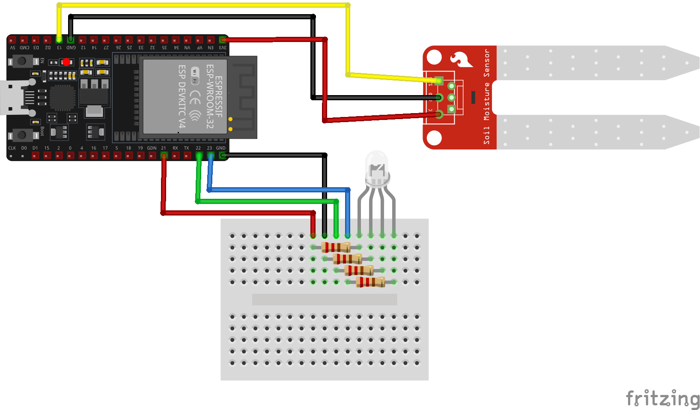
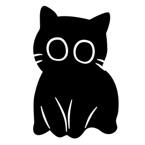

<p align="center" width="100%">
     
</p>

KittyPlant is an IoT project created as university assigment to help you keep your plants in good condition :muscle:

## Table of contents
* [General info](#general-info)
* [Electronic Circuit Design](#electronic-circuit-design)
* [Technologies](#technologies)
* [Setup](#setup)

## General info

KittyPlant is an IoT project created to take care of your lovely plants :heart: with silly cats theme :cat:
The system uses a soil moisture sensor to monitor the moisture levels in the soil and provides real-time feedback to users.

This project combines hardware and software components to create a seamless experience for plant care. Built on ESP32 DevKit for cheap and fast development. It is designed to be user-friendly, customizable, and suitable for a variety of plant types. Whether you're a beginner or an experienced gardener, KittyPlant helps you take better care of your plants with minimal effort.

<p align="center" width="100%">

</p>

#### Features
- Login/Register User
- Add new device
- Add custom plant to database
- Real-time data from you sensor
- Multiple device compatibility

#### Future Plans:
- [x] Profile page
- [x] Charts for analyze
- [x] Checking the insolation
- [x] Automatic watering system
- [ ] Automatically detect ESP32 devices connected to the computer via USB and configure them from the web dashboard
- [ ] Automatically flash new firmware versions onto the detected ESP32 from the web dashboard over USB
- [ ] 3D Components to assemble


## Electronic Circuit Design



## Technologies

- Backend
    - [Go v1.24.0](https://go.dev/)
    - [Gin](https://gin-gonic.com/)
    - [Gorm](https://gorm.io/)
    - [Phao MQTT](https://github.com/eclipse-paho/paho.mqtt.golang)

- Frontend
    - [React](https://react.dev/) + [Vite](https://vite.dev/)
    - [Tailwindcss](https://tailwindcss.com/)
    - [Shadnc](https://ui.shadcn.com/)

- ESP32
    - Arduino Framework
    - C++
    - [PlatformIO](https://platformio.org/)
    - [MQTTClient](https://github.com/256dpi/arduino-mqtt)
    - [ArduinoJson](https://arduinojson.org/)
 
 - Web Server
    - [Nginx](https://nginx.org/)

## Setup

### Install on Linux

Install Git, Docker Engine with Compose v2 (`docker compose up --wait-timeout`), OpenSSL, curl, and `flock` (from `util-linux`). The account running setup needs access to Docker. The server needs free TCP ports `443` for HTTPS and `8883` for MQTT over TLS.

Clone the deployment branch and replace `192.168.1.42` with the server's LAN IPv4 address or a DNS name that resolves to it from the browser and ESP32.

```bash
git clone --branch codex/server-setup https://github.com/PeterSaletra/KittyPlant.git
cd KittyPlant
bash setup.sh --host 192.168.1.42
```

On the first run, the installer generates `.env` and TLS certificates, builds the backend and frontend from the checkout, starts all services, and checks the website and API over HTTPS. It prints the site address when both checks pass.

For an existing checkout, save any local changes before running `git fetch origin` and `git switch --track origin/codex/server-setup`. If the branch is already checked out, update it with `git pull --ff-only`.

### Open the dashboard from the LAN

1. Copy the public certificate `.data/tls/web-ca.crt` from the server to the computer running the browser.
2. Import it into the computer's trusted root certificate store. On Windows, open `certmgr.msc` and import it under **Trusted Root Certification Authorities → Certificates**. [Windows certificate import documentation](https://learn.microsoft.com/en-us/windows-hardware/drivers/install/certificate-stores)
3. Open the HTTPS address printed by setup, for example `https://192.168.1.42`, and register an account on a fresh installation.

`--host` sets the address in the TLS certificates. Docker publishes ports `443` and `8883` on all host interfaces. For LAN-only access, restrict both ports to the LAN subnet with firewall rules that apply to published Docker ports, and keep WAN port forwarding disabled on the router. [Docker firewall documentation](https://docs.docker.com/engine/network/packet-filtering-firewalls/)

### Update or reset an installation

Run `git pull --ff-only` and `bash setup.sh` from the project directory to rebuild with the latest source. Setup reuses the saved host, credentials, certificates, and data volumes.

**Reset removes existing accounts, measurements, Redis data, and Mosquitto state.** From a configured checkout, run the following command and type `RESET` when prompted.

```bash
bash setup.sh --reset
```

The installer saves the previous `.env` under `.data/env.backup.*`, generates fresh credentials, and reuses the TLS certificates. When migrating an older deployment with no installer-generated certificates, pass `--host` with the LAN address. When replacing the TLS certificates, import the new web CA and upload the new ESP32 certificates after setup.

### Verify or troubleshoot

Run these commands on the server from the KittyPlant directory. The health endpoint should return `{"status":"ok"}`.

```bash
docker compose ps
curl --noproxy '*' --cacert .data/tls/web-ca.crt https://127.0.0.1/api/healthcheck
docker compose logs --since=5m --tail=50 postgres redis broker backend nginx
```

### ESP32

Connect the hardware as shown in the [circuit design](#electronic-circuit-design). Set `mqtt_server` in `esp32/include/config.h` to the address used for `--host`. The firmware connects to port 8883.

Copy `ca.crt`, `kp-0001.crt`, and `kp-0001.key` from the server's `.data/tls/esp32/` to the local `esp32/data/` directory. Keep the device key private. An ESP32 provisioned with a previous CA needs the files from the new installation.

With the ESP32 connected over USB, upload the filesystem and firmware from the local checkout. [PlatformIO filesystem upload documentation](https://docs.platformio.org/en/latest/platforms/espressif32.html#uploading-files-to-file-system)

```bash
cd esp32
pio run -t uploadfs
pio run -t upload
```

<p align="center" width="100%">

</p>
